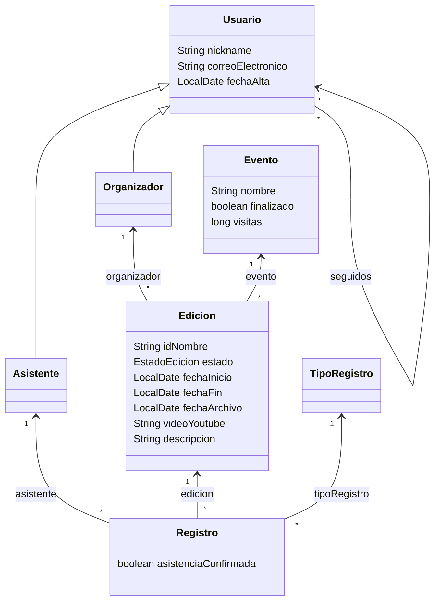
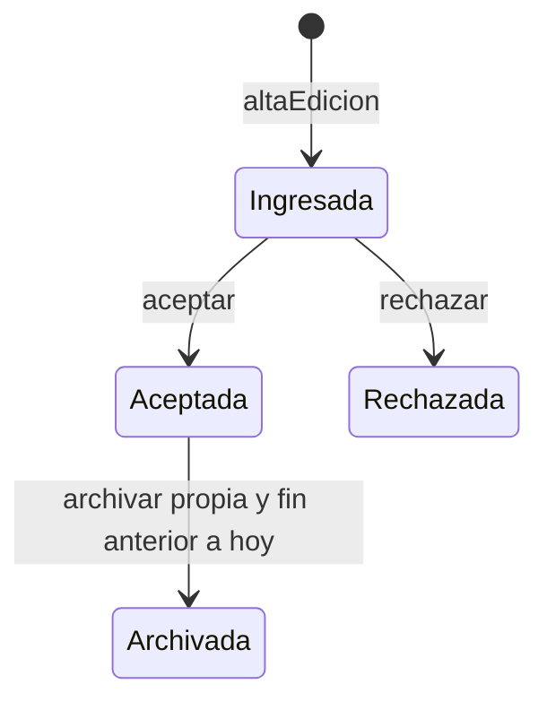
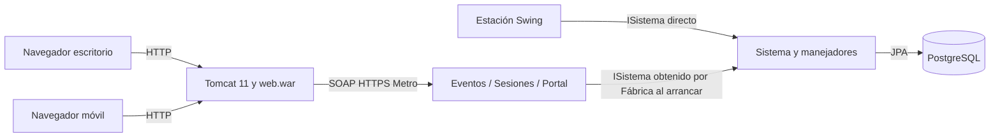
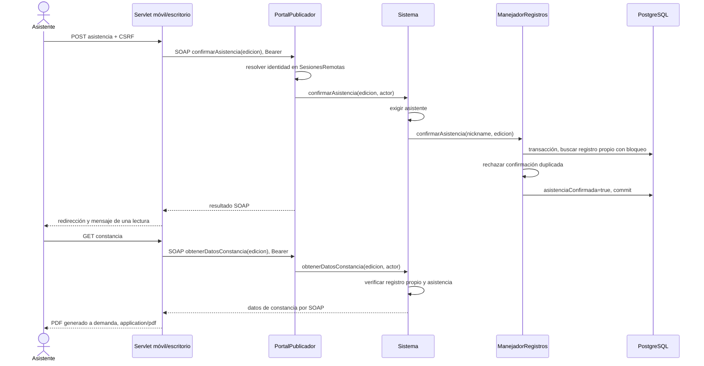
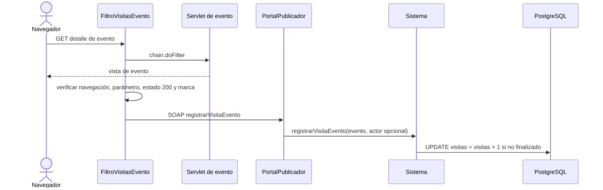
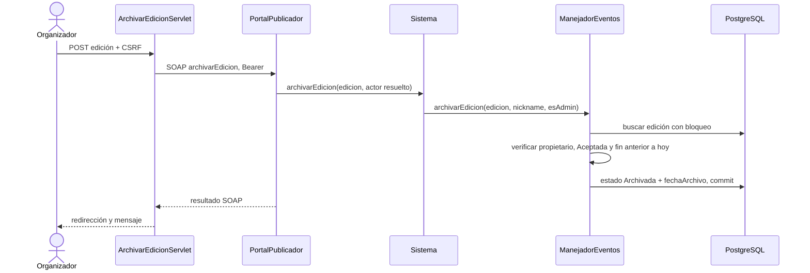

# Análisis y diseño Lab 3: correspondencia con la implementación

Complementa [DEFENSA_ARQUITECTURA](DEFENSA_ARQUITECTURA.md) y representa clases y llamadas existentes. Los diagramas no acreditan despliegue físico.

## Modelo de los cambios

`Usuario.seguidos` se mapea a `seguimiento_usuario`, con unicidad seguidor/seguido y restricción contra seguimiento a sí mismo. `ManejadorUsuarios.cambiarSeguimiento` conserva idempotencia mediante `ON CONFLICT`; no crea relaciones duplicadas. Los estados se persisten como enumerados de texto. `Edicion.archivar` acepta exclusivamente Aceptada, con fin anterior al día actual, y registra fecha de archivo. `Registro.confirmarAsistencia` impide segunda confirmación.

La asistencia exige registro propio y confirmación única; no incorpora restricciones de fecha/estado que no figuran en §6.3 de la letra. Archivar conserva registros. Finalizar un evento impide nuevas ediciones y lo excluye de consultas públicas y búsqueda; el administrador local sigue consultándolo.

## Componentes y frontera

`central.Main` configura JPA, publica endpoints y abre Swing. `ServidorHttpsCentral` comparte el registro `SesionesRemotas` entre Sesiones y Portal. Los proxies generados se crean por invocación y reemplazan su endpoint desde configuración externa. Credenciales remotas viajan por encabezado Authorization; la identidad no se acepta como parámetro libre de negocio.

La red transporta los DTO JAXB de `contratos.dto` y los tipos SOAP de Eventos/Sesiones, enumerados, colecciones y `byte[]`. `ConversorDatos` adapta tipos de fechas/colecciones y excluye contraseñas de salidas. Las excepciones declaradas se convierten a SOAP Fault con códigos de negocio/permiso/sesión y errores técnicos sanitizados. La web no incluye entidades ni JPA como dependencias de producción.

## Secuencia: asistencia y constancia

La generación de PDF está en `GeneradorConstanciaPdf`; la secuencia describe el código existente. Su ejecución con PDFBox queda sujeta a disponer de la dependencia real, y no se sustituye por una respuesta simulada.

## Secuencia: visitas

El filtro solo cubre `/evento` y `/movil/eventos`, y excluye recursos auxiliares. Fallos al informar la visita se registran sin exponer credenciales ni reemplazar la página ya entregada. Swing obtiene el top cinco persistido por `ISistema`, fuera del EDT.

## Secuencia: archivo

Configuración privada: `~/.eventosUy/central.properties` y `web.properties`. El archivo alternativo de pruebas `eventos.web.config` se aplica a los tres clientes. La versión móvil comparte WAR, SOAP, identidad y servlets de soporte, con vistas propias en `WEB-INF/views/movil` y Bootstrap local.
