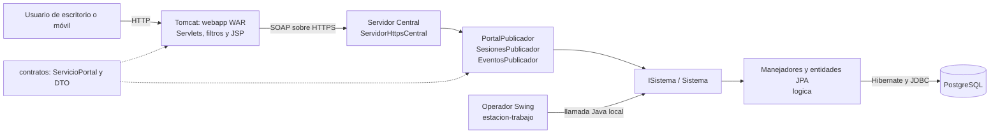

# Defensa técnica: arquitectura de Eventos UY, Laboratorio 3

Análisis estático del commit `e6c863ab216439c720c46ead81b916d5e3b4c15b` de `lab3-integracion-equipo`. Las rutas siguientes son relativas a la raíz del repositorio. Este documento describe el código actual; no presupone que los servicios estén iniciados en una instalación particular.

## 1. Módulos y dependencias

El [POM raíz](../../pom.xml) declara cinco módulos Maven:

| Módulo | Responsabilidad y archivo de referencia |
| --- | --- |
| `contratos` | API y DTO independientes de la persistencia: `contratos/src/main/java/contratos/ServicioPortal.java`, `contratos/src/main/java/contratos/dto/` y `contratos/src/main/java/contratos/ConversorDatos.java`. Su [POM](../../contratos/pom.xml) produce un JAR. |
| `logica` | Reglas del negocio, entidades y JPA: `logica/src/main/java/interfaces/ISistema.java`, `logica/src/main/java/implementacion/Sistema.java`, `logica/src/main/java/manejadores/`, `logica/src/main/java/clases/` y `logica/src/main/java/persistencia/BaseDeDatos.java`. Su [POM](../../logica/pom.xml) incorpora Hibernate y el driver PostgreSQL. |
| `estacion-trabajo` | Interfaz Swing de administración: `estacion-trabajo/src/main/java/swing/principal.java` y sus paneles. Su [POM](../../estacion-trabajo/pom.xml) depende de `logica`. |
| `servidor-central` | Proceso principal, HTTPS y tres fachadas SOAP: `servidor-central/src/main/java/central/Main.java`, `central/ServidorHttpsCentral.java` y `central/soap/`. Su [POM](../../servidor-central/pom.xml) depende de `contratos`, `logica` y `estacion-trabajo`, y configura un JAR ejecutable con `central.Main`. |
| `webapp` | WAR para Tomcat: servlets, filtros, JSP y clientes SOAP en `webapp/src/main/java/web/`, `webapp/src/main/java/web/remoto/` y `webapp/src/main/webapp/WEB-INF/views/`. Su [POM](../../webapp/pom.xml) depende en ejecución de `contratos` y del cliente JAX-WS; `servidor-central` y `logica` tienen alcance **test**. |

**Relación entre procesos.** `central.Main.main` inicializa JPA, obtiene `ISistema` mediante `Fabrica.getISistema`, publica SOAP HTTPS y, salvo `--sin-swing`, llama a `swing.principal.main`. Swing y Central comparten proceso y llaman a la lógica Java directamente; por ejemplo, `swing/AltaEventoPanel.java` obtiene `ISistema` de `Fabrica`. La Webapp vive en Tomcat: `ContextoListener.central` crea un `ClienteCentral` y sus operaciones viajan a Central por SOAP HTTPS. El WAR no necesita las clases de `logica` en tiempo de ejecución; las dependencias a lógica y Central de su POM son para pruebas.

Las líneas punteadas representan tipos compartidos y conversión de DTO, no una conexión de red. En ejecución, `ServidorHttpsCentral.iniciar` publica las fachadas en un único `HttpsServer` con rutas configuradas para eventos, sesiones y portal.

### Mapa de clases y métodos para recorrer en el IDE

| Componente | Ruta exacta | Clase y método |
| --- | --- | --- |
| Arranque Central | `servidor-central/src/main/java/central/Main.java` | `central.Main.main` |
| HTTPS y endpoints | `servidor-central/src/main/java/central/ServidorHttpsCentral.java` | `central.ServidorHttpsCentral.iniciar`, `publicar` |
| Configuración y conexión Central | `servidor-central/src/main/java/central/ConfiguracionCentral.java` | `central.ConfiguracionCentral.propiedadesJpa` |
| Contrato Java | `contratos/src/main/java/contratos/ServicioPortal.java` | `contratos.ServicioPortal.confirmarAsistencia` |
| Fachada SOAP | `servidor-central/src/main/java/central/soap/PortalPublicador.java` | `central.soap.PortalPublicador.confirmarAsistencia`, `actor` |
| Arranque Swing | `estacion-trabajo/src/main/java/swing/principal.java` | `swing.principal.main` |
| Arranque Web | `webapp/src/main/java/web/ContextoListener.java` | `web.ContextoListener.contextInitialized`, `central` |
| Cliente Web | `webapp/src/main/java/web/remoto/ClienteCentral.java` | `web.remoto.ClienteCentral.puerto`, `confirmarAsistencia` |
| Controlador móvil | `webapp/src/main/java/web/MovilAsistenciaServlet.java` | `web.MovilAsistenciaServlet.doPost` |
| Vista móvil | `webapp/src/main/webapp/WEB-INF/views/movil/registros.jsp` | Formulario POST a `/movil/asistencia` |
| Servicio de negocio | `logica/src/main/java/implementacion/Sistema.java` | `implementacion.Sistema.confirmarAsistencia` |
| Persistencia de asistencia | `logica/src/main/java/manejadores/ManejadorRegistros.java` | `manejadores.ManejadorRegistros.confirmarAsistencia` |
| Entidad persistente | `logica/src/main/java/clases/Registro.java` | `clases.Registro.confirmarAsistencia` |
| Fábrica JPA | `logica/src/main/java/persistencia/BaseDeDatos.java` | `persistencia.BaseDeDatos.inicializar(Map)`, `getEntityManager` |

## 2. Contratos SOAP y su implementación

- **Contrato Java para el consumidor:** `contratos/src/main/java/contratos/ServicioPortal.java` define, entre otras, `confirmarAsistencia`, `registrarVisitaEvento` y `buscarEventosYEdiciones`. Los tipos de intercambio están en `contratos/src/main/java/contratos/dto/`. `ClienteCentral` implementa esa interfaz en la Webapp; `ConversorDatos.convertir` adapta DTO compartidos y clases generadas por JAX-WS.
- **Contrato de transporte:** `webapp/src/main/resources/wsdl/PortalService.wsdl` y `PortalService_schema1.xsd` describen operaciones y tipos SOAP; existen pares equivalentes `SesionesService.*` y `EventosService.*`. `webapp/pom.xml` ejecuta `wsimport` para generar los puertos `web.soap.generado.*`. `servidor-central/pom.xml` ejecuta `wsgen` sobre las fachadas anotadas con `@WebService` y `@WebMethod`.
- **Implementación del servidor:** `servidor-central/src/main/java/central/soap/PortalPublicador.java` expone las operaciones del portal y delega en `ISistema`; `SesionesPublicador.java` delega en `SesionesRemotas`; `EventosPublicador.java` expone el listado público. `central/ServidorHttpsCentral.java`, método `iniciar`, publica las tres instancias en HTTPS. El listado público de `EventosService` es una fachada aparte; no hay una clase `ServicioEventos` en el módulo `contratos`.
- **Autenticación:** `webapp/src/main/java/web/remoto/ClienteCentral.java`, método `puerto`, pone la credencial de `SesionWeb` en `Authorization: Bearer` y configura el destino HTTPS. `PortalPublicador.actor` la interpreta mediante `CredencialesSoap` y `SesionesRemotas`. `ClienteSesionesCentral.iniciarMovil` usa el servicio separado de sesiones; `SesionesPublicador.iniciarSesionMovil` emite la sesión. Los detalles del error técnico se convierten en un fault genérico en `PortalPublicador.invocar`.

## 3. PostgreSQL, JPA y arranque

El punto de entrada del servidor es `servidor-central/src/main/java/central/Main.java`, método `main`. Lee `%USERPROFILE%/.eventosUy/central.properties` mediante `ConfiguracionCentral`, prepara HTTPS, llama a `BaseDeDatos.inicializar(configuracion.propiedadesJpa())`, publica SOAP y luego abre Swing (opcional). El [POM de Central](../../servidor-central/pom.xml) fija `central.Main` en el manifiesto del JAR sombreado; el arranque previsto es `java -jar servidor-central/target/servidor.jar` (se puede pasar `--sin-swing`).

`ConfiguracionCentral.propiedadesJpa`, en `servidor-central/src/main/java/central/ConfiguracionCentral.java`, lee `db.url`, `db.usuario` y `db.password`, exige una URL `jdbc:postgresql://` y fija `hibernate.hbm2ddl.auto=validate`. `BaseDeDatos.inicializar(Map)`, en `logica/src/main/java/persistencia/BaseDeDatos.java`, entrega esas propiedades a `Persistence.createEntityManagerFactory("postgres", ...)`. `logica/src/main/resources/META-INF/persistence.xml` declara la unidad `postgres`, el proveedor `org.hibernate.jpa.HibernatePersistenceProvider` y las entidades JPA. Aunque ese XML contiene un valor predeterminado `update`, **el arranque de Central lo sobrescribe con `validate`**: valida el esquema existente y no crea ni migra tablas. `BaseDeDatos.getEntityManager` entrega un `EntityManager` a los manejadores; éstos delimitan las transacciones. La ruta alternativa `BaseDeDatos.inicializar()` toma las cinco variables `EVENTOS_DB_*` del entorno, usada por pruebas y herramientas que la invocan; no es la configuración de `central.Main`.

El punto de entrada Swing es `estacion-trabajo/src/main/java/swing/principal.java`, método `main`, invocado normalmente por Central; usa `SwingUtilities.invokeLater` para crear la ventana. El punto de entrada Web es el despliegue del WAR `webapp` en Tomcat: `webapp/src/main/java/web/ContextoListener.java`, método `contextInitialized`, carga `%USERPROFILE%/.eventosUy/web.properties` (o la ruta de `eventos.web.config`) mediante `ConfiguracionWeb.cargar`. Cada petición entra por servlets anotados con `@WebServlet`, por ejemplo `webapp/src/main/java/web/InicioServlet.java` (`/inicio`) y `MovilAsistenciaServlet.java` (`/movil/asistencia`). `webapp/src/main/java/web/FiltroAcceso.java` (`@WebFilter("/*")`) comprueba CSRF en POST, refresca la sesión contra Central y aplica acceso por rol; `AccesoMovil.requerirAsistente` redirige al login móvil cuando corresponde.

## 4. Caso completo: confirmar asistencia desde el móvil

1. En `webapp/src/main/webapp/WEB-INF/views/movil/registros.jsp`, el asistente elige un registro y envía el formulario POST a `/movil/asistencia` con el nombre de edición y `_csrf`. `MovilRegistrosServlet.doGet` consulta sus registros por SOAP y presenta el botón si la asistencia no consta. No consulta el detalle público de una edición que podría estar archivada ni añade restricciones de fecha que no pide §6.3. Esta condición de vista no sustituye la validación del servidor.
2. `FiltroAcceso.doFilter` valida el POST y la sesión; `MovilAsistenciaServlet.doPost` usa `AccesoMovil.requerirAsistente` y llama a `ContextoListener.central(req).confirmarAsistencia(edicion)`. En producción, `ContextoListener.central` devuelve un `ClienteCentral` con la credencial de la `HttpSession`.
3. `ClienteCentral.confirmarAsistencia` llama al puerto generado de `PortalService.wsdl` sobre HTTPS. `PortalPublicador.confirmarAsistencia` obtiene el actor de la credencial mediante `actor(true)` y delega en `ISistema.confirmarAsistencia`. La operación también figura en `PortalService_schema1.xsd`.
4. `Sistema.confirmarAsistencia`, en `logica/src/main/java/implementacion/Sistema.java`, exige un asistente y un nombre de edición. `ManejadorRegistros.confirmarAsistencia`, en `logica/src/main/java/manejadores/ManejadorRegistros.java`, abre un `EntityManager`, inicia la transacción y busca el registro propio por asistente y edición con bloqueo `PESSIMISTIC_WRITE`. `Registro.confirmarAsistencia`, en `logica/src/main/java/clases/Registro.java`, rechaza una segunda confirmación y cambia `asistenciaConfirmada` a `true`. El manejador hace `commit`; ante una excepción hace `rollback` y cierra el `EntityManager`. La fecha y el estado de edición no son restricciones adicionales de este caso según §6.3.
5. Hibernate mapea `Registro` a la tabla PostgreSQL `registro` y la propiedad a una columna booleana no nula. La respuesta SOAP vuelve a `ClienteCentral`. `MovilAsistenciaServlet.doPost` guarda un mensaje de una lectura y redirige a `/movil/registros`; `MovilRegistrosServlet.doGet` consulta nuevamente Central y la JSP muestra **Asistió**. Las excepciones de negocio se traducen a fault `DATOS_INVALIDOS` y, en el cliente, a `IllegalArgumentException` para mostrar advertencia; un fallo técnico se comunica como servicio no disponible.

## 5. Diez preguntas posibles del tribunal

1. **¿Por qué Swing no llama por SOAP?** Porque `central.Main.main` inicia `swing.principal.main` en el mismo proceso y los paneles, como `swing/AltaEventoPanel.java`, obtienen `ISistema` de `Fabrica`. SOAP es la frontera con la Webapp remota.
2. **¿Qué impide que Tomcat acceda directamente a PostgreSQL?** La implementación de `ContextoListener.central` crea `ClienteCentral`; `webapp/pom.xml` sólo incluye `logica` y `servidor-central` con alcance `test`. No se inicializa JPA en el listener Web.
3. **¿Cuál es la diferencia entre `ServicioPortal` y el WSDL?** `ServicioPortal.java` es la interfaz y DTO usados por el código Web; `PortalService.wsdl` y su XSD describen el protocolo SOAP. `ClienteCentral` adapta la primera al puerto generado por `wsimport`; `PortalPublicador` implementa el extremo servidor.
4. **¿Dónde se verifican los permisos reales?** La Webapp filtra y presenta opciones (`FiltroAcceso`, `AccesoMovil`), pero `PortalPublicador.actor(true)` resuelve la credencial y `Sistema.confirmarAsistencia` exige el rol. `ManejadorRegistros` busca exclusivamente el registro del asistente autenticado y `Registro` rechaza confirmar dos veces. No se agregan restricciones de fecha o estado ausentes en §6.3.
5. **¿Qué pasa si una sesión móvil vence?** `FiltroAcceso.responderError` invalida la sesión local ante `SESION_INVALIDA` y redirige las rutas `/movil/*` a `/movil/login?motivo=vencida`, no al login de escritorio.
6. **¿Cómo evitan confirmar dos veces?** `ManejadorRegistros.confirmarAsistencia` busca el registro con bloqueo pesimista y `Registro.confirmarAsistencia` rechaza cuando el booleano ya es `true`; el manejador revierte la transacción ante la excepción.
7. **¿Quién controla el esquema de PostgreSQL?** `ConfiguracionCentral.propiedadesJpa` y `BaseDeDatos.inicializar(Map)` fuerzan `hibernate.hbm2ddl.auto=validate` en el proceso Central. Las migraciones SQL se administran aparte; el arranque normal no debe alterar el esquema.
8. **¿Cómo se protege la conexión Web–Central?** `ConfiguracionWeb.validar` exige URI HTTPS; `ServidorHttpsCentral` crea un `HttpsServer` con `SSLContext` de un PKCS#12; `ClienteCentral.puerto` usa JAX-WS y la validación TLS de la JVM, además del encabezado Bearer para operaciones con sesión.
9. **¿Cómo se evita revelar errores internos al navegador?** `PortalPublicador.invocar` transforma errores de dominio en faults tipados y usa un mensaje genérico para fallos técnicos; `ClienteCentral.invocar` convierte el fault en `IllegalArgumentException` o `ErrorCentral`, que `FiltroAcceso` procesa.
10. **¿Dónde está la transacción del caso de asistencia?** En `ManejadorRegistros.confirmarAsistencia`: `tx.begin()`, consulta y modificación de la entidad administrada, `tx.commit()`, `tx.rollback()` ante error y `em.close()` en `finally`. Hibernate ejecuta el acceso JDBC a PostgreSQL a partir del mapeo JPA de `Registro`.

Para demostrar el recorrido sin modificar datos, abrir las clases indicadas en ese orden y mostrar `webapp/src/test/java/web/MovilVideoYAsistenciaTest.java` y `webapp/src/test/java/web/soap/PortalPersistenciaHttpsTest.java` como evidencia de pruebas existentes. Esta preparación documental no ejecutó esas pruebas.
