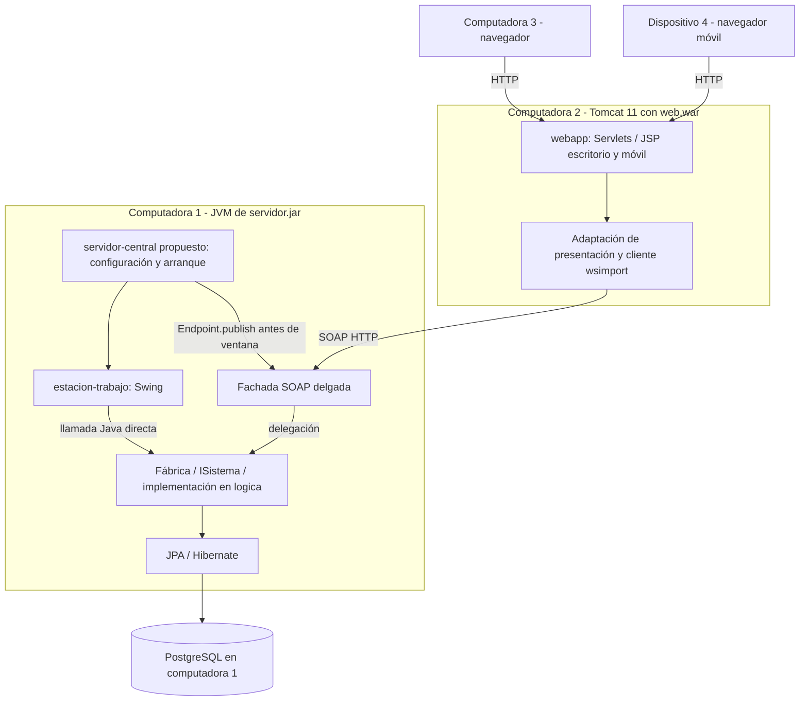

# Laboratorio 3 — Roadmap de preparación e implementación

## 1. Objetivo y límites de esta etapa

Evolucionar eventos.uy hacia la distribución exigida por `Laboratorio 3.pdf`: Central con lógica, JPA, PostgreSQL y Swing; Web separado que consume SOAP; escritorio y móvil desde el mismo WAR. Conservar los casos anteriores e implementar los cambios de §6 y §7, con al menos 80 % de líneas de lógica y entrega/defensa reproducible sin IDE.

**Preparación, 05/11/2026:** rama `lab3-desarrollo` desde `dev` en `5fb46db2743c10609c470c78b71ed8c210e8ba14`. Solo estos tres documentos se incorporan en esta fase. `dev` no se modifica; PDF y demo se preservan, excluidos únicamente en `.git/info/exclude` local. No se incorporan dependencias, código funcional ni cambios PostgreSQL.

Fuentes: letra completa, [requisitos trazados](REQUISITOS.md), [demo analizada](REFERENCIA_WEBSERVICES.md), `pom.xml`, `logica/pom.xml`, `estacion-trabajo/pom.xml` y `webapp/pom.xml`. Esta revisión estructural no es otra auditoría del Lab 2 ni valida nuevamente sus resultados históricos.

## 2. Punto de partida Maven comprobado

El agregador `uy.edu.utec:eventos-uy:1.0-SNAPSHOT` tiene tres módulos, release Java 25 y perfil `cobertura` con JaCoCo 0.8.16, informes HTML/XML.

| Módulo existente | Empaquetado/dependencias relevantes | Evolución propuesta, todavía no implementada |
| --- | --- | --- |
| `logica` | JAR; JPA 3.2.0, Hibernate 7.1.1.Final, PostgreSQL 42.7.7, ImageIO WEBP 3.15.3; JUnit 5.12.2 y H2 de test. | Mantener negocio y persistencia en Central; agregar casos del Lab 3 en etapas posteriores. |
| `estacion-trabajo` | JAR dependiente de `logica`. | Mantener Swing y llamadas directas; integrar su arranque en el ejecutable Central. |
| `webapp` | WAR dependiente de `logica`; Servlet/JSP provided, JSTL y JUnit. | Quitar dependencia de lógica cuando se migren consumidores; usar cliente SOAP generado; agregar móvil en el mismo WAR. |

La dependencia actual `webapp → logica` corresponde al Lab 2, no a la arquitectura final permitida del Lab 3. No se modifica en esta preparación.

## 3. Arquitectura Maven propuesta

Agregar posteriormente **un módulo nuevo `servidor-central`** como raíz de composición y empaquetado. Ese directorio/POM aún no existe. No hace falta mover las clases actuales ni introducir un módulo compartido de entidades/DTO productivos en el WAR.



### Dependencias de compilación previstas

```text
eventos-uy (agregador, cuatro módulos propuestos)
  logica                 → JPA / Hibernate / PostgreSQL / ImageIO
  estacion-trabajo        → logica
  servidor-central NUEVO → logica + estacion-trabajo + Metro
  webapp                 → cliente generado desde WSDL + Metro + Servlet/JSP/JSTL

webapp NO → logica / estacion-trabajo / servidor-central / JPA / PostgreSQL
```

- `servidor-central` contendría bootstrap, configuración y fachada SOAP; puede contener DTO específicos del transporte y sus conversiones, siempre sin negocio ni acceso directo a entidades desde el publicador. El negocio sigue en lógica.
- La fachada obtiene los controladores mediante la Fábrica. Swing mantiene `ISistema` local. Se diseñarán las operaciones nuevas y la adaptación de contrato antes de alterar API; no se presume que toda firma local se puede publicar sin cambios.
- El consumidor web usará clases generadas propias y una adaptación de presentación a sus vistas/sesión. No incluir el JAR de lógica solo para conservar imports de `Dt*` o `ISistema`; esa comodidad violaría la separación requerida.
- Contrato WSDL/XSD propio versionado con el consumidor, generación Maven; fuentes generadas en `target`, no edición manual. Sin ciclo de dependencia ni necesidad de tener Central encendido para un build normal de contrato ya actualizado.
- FinalName futuro: `servidor-central/target/servidor.jar` y `webapp/target/web.war`. Los JAR intermedios pueden existir al construir, pero los dos artefactos de ejecución/distribución son los pedidos.
- Proponer Shade para el JAR, con manifiesto y unión de proveedores `META-INF/services`; probar Metro/JAXB/JPA/ImageIO desde el artefacto real. La elección de Shade es de diseño, no obligación de plugin exacto.
- Configuración propuesta: `~/.eventosUy/central.properties` y `web.properties`. Directorio obligatorio; nombres de archivo y claves por definir/documentar. URL/user/password PostgreSQL solo Central; web únicamente datos del endpoint. Recursos incluidos en los artefactos.
- Móvil: ruta propuesta `/movil` relativa al contexto (por ejemplo `/web/movil` al desplegar `web.war` con ese contexto), vistas pequeñas con Bootstrap local y controladores/acceso SOAP reutilizados. El contexto no debe codificarse como constante.
- Constancia: se propone generación a demanda en Web con datos obtenidos por SOAP y autorización previa; elegir biblioteca/licencia en su etapa y solicitar aprobación antes de agregarla. Generación Central con `byte[]` también está admitida; no es necesario decidirla en esta preparación.

### Alternativa considerada

Convertir directamente `estacion-trabajo` en el ejecutable con SOAP evita un módulo, y sería compatible con la letra. Se recomienda el módulo de composición adicional para aislar arranque/red/empaquetado de paneles y conservar la separación existente. La letra fija nodos y artefactos, no un número de módulos: **cuatro módulos es una propuesta pendiente de aprobación**, no un requisito ni una reorganización ya realizada.

## 4. Fases, dependencias y criterios de salida

| Fase | Trabajo y orden | Depende de | Criterio de finalización |
| --- | --- | --- | --- |
| 0 — Preparación | Leer letra/demo, preservar referencias, rama aislada y estos tres documentos. | Base dev limpia y sincronizada. | Commit solo documental publicado, upstream correcto y dev intacta. Es la única fase realizada aquí. |
| 1 — Contratos y diseño | Revisar firmas/DTO requeridos para la frontera remota; definir mapa de operaciones, fechas, faults, identidad/propiedad y configuración; resolver ambigüedades. | 0 y autorización para continuar. | Diseño pequeño revisable, trazado a requisitos, sin entidades en contrato ni reglas supuestas. |
| 2 — Corte vertical distribuido | Agregar composición Central y dependencias autorizadas; properties/EMF; publicar una consulta existente, generar cliente, consumirla desde una pantalla web. Publicar antes de Swing. | 1. | `servidor.jar` + WAR preliminar, consulta SOAP real desde otra computadora; cambio de endpoint sin rebuild; página controlada si Central cae. |
| 3 — Migración completa de web | Migrar lecturas/escrituras anteriores, autenticación, perfiles, estados, imágenes y patrocinios al cliente SOAP; preservar sesiones/roles/CSRF/PRG/validaciones. Quitar dependencia de lógica de web. | 2. | Todos los casos previos funcionan distribuidos; árbol de dependencias y contenido de WAR sin lógica/JPA/PostgreSQL. |
| 4 — Modelo y casos nuevos | Seguidores; video; finalizar eventos; archivar ediciones; asistencia; consultas/visibilidad; constancia PDF. Entregar cada corte con pruebas lógicas. | 3; diseño de cada caso en 1. | Persistencia y reglas de §4–6 verificadas; sin pérdida de registros ni exposición de datos privados. |
| 5 — Búsqueda e interacción | Búsqueda con filtros/órdenes; disponibilidad con fetch/async-await; filtro de visitas desktop/móvil y top cinco Swing. | 3; estados de 4 antes de cerrar filtros. | Búsqueda y contadores persistentes probados, filtro sin editar servlets existentes para el conteo; validación backend sigue vigente. |
| 6 — Móvil | Ruta propia, login solo asistente, navegación responsive, consulta edición/registro, asistencia y video. Reutilizar acceso SOAP/controladores. | 3 y asistencia/video de 4; coordinar filtro de 5. | §6.3 y §7.3 recorridos en teléfono real con navbar/hamburguesa y diseño sin desbordes. |
| 7 — Cierre y defensa | Regresión completa, cobertura, dominio/DSS/diseño actualizados, seed demostrable, README, build limpio y ensayo en cuatro dispositivos sin IDE. | 4, 5 y 6. | Todos los criterios de REQUISITOS con evidencia, ≥80 % líneas de lógica, dos paquetes reproducibles, ninguna dependencia oculta. |

Las fases 4–6 admiten trabajo separado después de estabilizar el contrato y coordinar cambios compartidos. Dentro de 4, primero estados/visibilidad, luego asistencia y constancia, para no construir interfaz sobre reglas indefinidas. Comenzar en paralelo la documentación de diseño al cerrar cada corte, no reconstruirla al final.

Orden temporal orientativo, no compromiso de funcionalidades ya realizadas: 5–6/11 contratos; 7–10/11 corte y migración SOAP; 11–15/11 casos/modelo; 16–18/11 búsqueda/interacción/móvil; 19–22/11 integración, documentación y ensayo. Entrega **23/11/2026 09:00**, defensa ese día según turno (§1 y §8). Ajustar el calendario con el equipo; no sacrificar ensayo LAN para agregar extras.

## 5. Riesgos y controles previstos

| Riesgo | Control mínimo antes de avanzar |
| --- | --- |
| DTO actuales no compatibles con JAXB, herencia o fechas que desaparecen en XML. | Inventario de firmas en fase 1, DTO de transporte explícitos y pruebas reales de ida/vuelta. No afirmar incompatibilidades concretas sin inspección posterior. |
| WAR sigue incluyendo lógica por dependencia transitiva o por reutilización de DTO. | Revisar `dependency:tree`, imports y listado de `WEB-INF/lib`; cliente generado separado. |
| Contrato cambia y consumidor queda obsoleto. | Versionar WSDL/XSD, procedimiento de actualización y regeneración; build limpio sin editar fuentes generadas. |
| Servicio disponible localmente pero inaccesible por LAN. | Ensayo temprano entre dos equipos; bind/URL, firewall, puertos y WSDL accesible; otro ensayo con cuatro dispositivos. |
| Shade pierde SPI o recursos de Metro/Hibernate/ImageIO. | Servicios combinados y ejecución real de JAR, incluida imagen WEBP, JPA y Swing. No validar solo desde IntelliJ. |
| Un singleton de proxy se comparte entre hilos. | Servicio generado reutilizable y puerto por operación/pedido según diseño; no compartir contexto mutable entre solicitudes. |
| Operación ejecutada pero respuesta SOAP perdida; reintento duplica efecto. | Mantener invariantes/duplicados en lógica y transacciones; no reintentar automáticamente escrituras sin política explícita. |
| Identidad web se reduce a un nickname arbitrario en llamadas sensibles. | Definir frontera de confianza y autorización por caso; no atribuir seguridad al WSDL ni copiar el ejemplo sin roles. Mantener privacidad de registros, imágenes y códigos. |
| Configuración de pruebas apunta a base habitual al migrar properties. | Conservar protección de pruebas y verificar base efectiva antes de JPA/esquema/escrituras; no usar datos de producción para pruebas. |
| Archivo/finalización eliminan o esconden indebidamente registros. | Matriz de visibilidad por rol, propios/ajenos y enlaces directos; pruebas de conservación. |
| Conteo no cubre móvil o se realiza dos veces. | Diseñar mappings/dispatchers del filtro y prueba desktop/móvil con incremento persistido. |
| Búsqueda omite descripción, estados o mezcla fechas. | Precisar fuente de descripción, casos de texto/vacío, filtros y órdenes; no agregar atributos a ciegas. |
| Disponibilidad asíncrona muestra una respuesta antigua como actual. | Evaluar debounce/control de respuestas obsoletas; siempre revalidar unicidad al guardar. No es sustituto de restricciones transaccionales. |
| YouTube/PDF presentan problemas de tamaño, autorización o recursos externos. | Validar URL/embed de forma localizada; PDF solo propio con asistencia; probar en celular. La reproducción de YouTube requiere acceso al proveedor. |
| 80 % del Lab 2 se toma como cobertura del nuevo código. | Medir de nuevo lógica completa con IntelliJ y usar JaCoCo como seguimiento adicional; conservar pruebas previas. |
| README presupone rutas/IDE/credenciales del equipo. | Instalar desde copia limpia y ejecutar solo artefactos y properties externas con datos de demostración. |

## 6. Preguntas que deben resolverse antes de codificar

Ver REQUISITOS, sección 6: autorización de finalización de eventos; descripción de edición para búsqueda; política de conteo y empates; ausencia de condición temporal explícita para confirmar asistencia; fechas/DTO/faults; identidad remota.

Además, acordar nombres/rutas del servicio y propiedades, agrupación de operaciones y procedimiento para actualizar el contrato. No fijar direcciones LAN reales ni contraseñas en fuentes o documentos. No agregar restricciones de negocio solo por ser prácticas habituales.

## 7. Estrategia de verificación por fase

1. Mantener suite anterior; nuevas pruebas JUnit de reglas y efectos persistidos del Central. No ejecutar persistencia contra la base habitual.
2. Cortes de integración SOAP recomendados: tipos/fechas/listas/enums/byte[], faults declarados, autenticación y autorización, timeouts e indisponibilidad.
3. Regresión web/Swing: mismas funciones y privacidad, ahora con la web remota; CSRF y multipart deben conservarse al transportar imágenes.
4. Verificación de paquetes: un comando Maven futuro documentado; `java -jar servidor.jar`; despliegue `web.war` en Tomcat 11 sin IDE; cambio de properties y reinicio sin reconstrucción.
5. Medición ≥80 % de líneas de lógica según §7.10 y documentación actualizada. Una prueba web o una invocación SOAP no reemplaza la medición de lógica.
6. Ensayo de cuatro dispositivos, tres roles web y administrador Swing; demo con todos los datos exigidos por §8. Registrar qué fue automático y qué fue visual real.

No se ejecutó Maven, JUnit, la demo ni PostgreSQL en esta fase exclusivamente documental. No se presentan métricas anteriores como una verificación nueva.

## 8. Estado y siguiente paso

- **ANALIZADO:** letra completa, referencia técnica y estructura Maven actual.
- **DOCUMENTADO:** requisitos, arquitectura propuesta, decisiones pendientes, dependencias, riesgos y criterios de salida.
- **IMPLEMENTADO en esta preparación:** únicamente los tres archivos Markdown y el aislamiento Git autorizado; ninguna funcionalidad Lab 3.
- **PENDIENTE:** aprobar arquitectura, fase 1 y toda implementación/configuración/despliegue/prueba del Lab 3.

Primer paso recomendado tras aprobación: diseñar el contrato mínimo de una consulta existente y su DTO/fault/configuración; después ejecutar el corte vertical de fase 2 entre dos equipos. No comenzar reescribiendo todas las pantallas ni implementando simultáneamente todos los casos nuevos.
